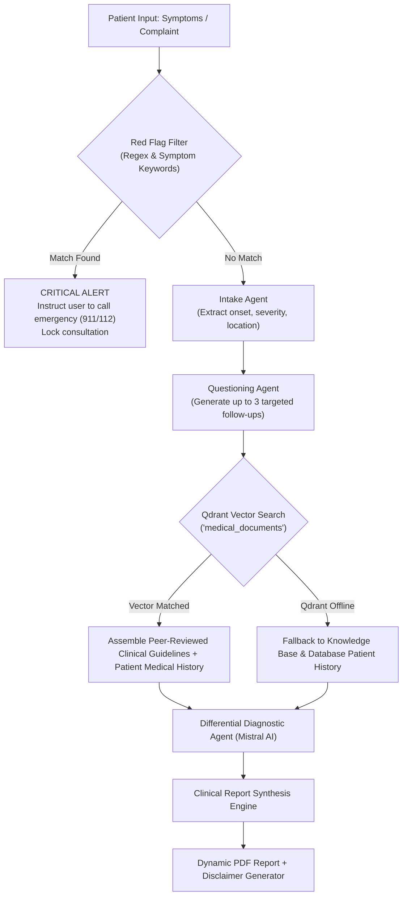

# AI & RAG Pipeline Specification

The DocAI system employs a clinical artificial intelligence pipeline combining **Mistral AI**, **LangGraph**, and **Qdrant Vector Database**.

---

## 1. Pipeline Overview



---

## 2. Mistral AI Integration & Rate Limit Resilience

The system leverages **Mistral AI** (`mistral-large-latest` and `open-mistral-7b`) for natural language clinical dialogue and differential reasoning.

### Exponential Backoff & Retry
To withstand API quotas and 429 rate limits, the Mistral client wraps requests in an automatic retry loop:
```typescript
// Retry with jittered exponential backoff
async function callMistralWithRetry(prompt, maxRetries = 3) {
  let attempt = 0;
  while (attempt < maxRetries) {
    try {
      return await client.chat.complete({ ... });
    } catch (err: any) {
      if (err.status === 429 && attempt < maxRetries - 1) {
        const delay = Math.pow(2, attempt) * 1000 + Math.random() * 500;
        await new Promise((res) => setTimeout(res, delay));
        attempt++;
        continue;
      }
      throw err;
    }
  }
}
```

---

## 3. Red-Flag Emergency Triage

Before routing messages to the LLM, inputs pass through a zero-latency keyword triage scanner (`emergencySymptoms.ts`):

- **Keywords tracked:** `chest pain`, `chest tightness`, `difficulty breathing`, `shortness of breath`, `stroke`, `facial drooping`, `arm weakness`, `thunderclap headache`, `loss of consciousness`, `unresponsive`, `seizure`, `severe bleeding`, `vomiting blood`, `anaphylaxis`, `throat closing`, `suicidal thoughts`.
- **Action taken:** When triggered, the consultation state switches to `EMERGENCY`. A persistent banner directs the patient to call emergency services immediately, and doctor booking shortcuts for urgent care are emphasized.

---

## 4. RAG Retrieval via Qdrant

### Vector Collection Details
- **Collection Name:** `medical_documents`
- **Metric:** Cosine Similarity
- **Payload Schema:**
  ```json
  {
    "documentId": "uuid",
    "patientId": "uuid",
    "text": "Extracted paragraph or clinical guideline",
    "category": "cardiology | respiratory | general",
    "source": "lab_report | clinical_guideline"
  }
  ```

### Graceful Fallback Strategy
If Qdrant Cloud or local Qdrant is unavailable or returns an authorization issue, the backend emits a warning (`Could not connect to Qdrant. RAG will fallback to DB text search`) and seamlessly queries the local PostgreSQL `MedicalHistory` and `Document` metadata tables. **The consultation never crashes or stalls for the patient.**

---

## 5. Report Generation & PDF Synthesis

Once an AI consultation is completed, a structured clinical summary is generated:
1. **Chief Complaint & Clinical Summary:** Concise recap of user complaints and symptoms.
2. **Possible Conditions:** Ranked list of differential diagnoses accompanied by estimated likelihood scores.
3. **Risk Level:** `LOW`, `MEDIUM`, `HIGH`, or `CRITICAL`.
4. **Recommended Specialties:** E.g., General Physician, Pulmonologist, Cardiologist.
5. **Suggested Medications:** Over-the-counter or supportive remedies (with clear warnings that prescription drugs require doctor authorization).
6. **Dynamic PDF Generation:** Built with `pdfkit` featuring clean typography, hospital-grade headers, diagnostic tables, and an unambiguous medical disclaimer banner.
