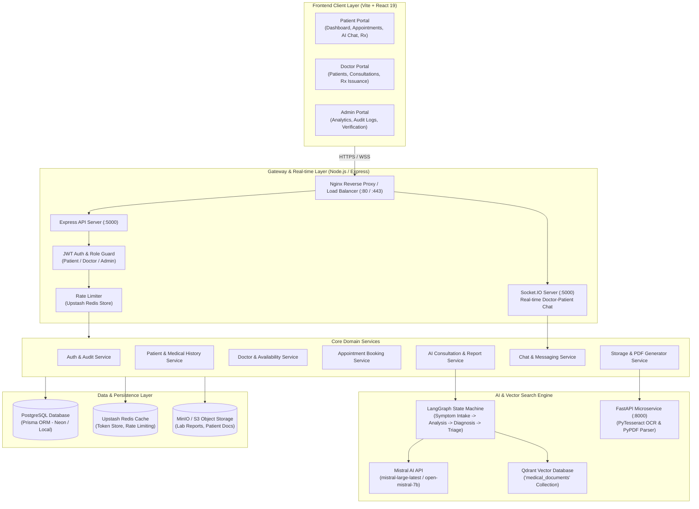
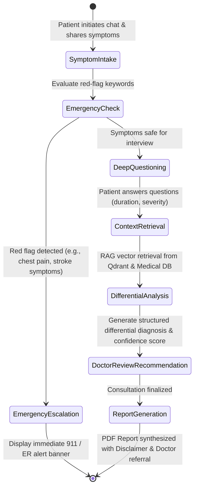
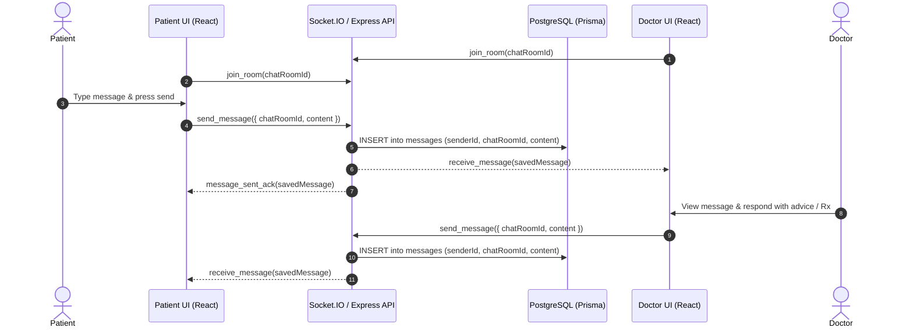
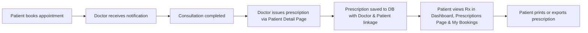

# System Architecture & Design

This document details the architectural layout, data flow, component interactions, and multi-agent AI pipeline of the **DocAI** platform.

---

## 1. High-Level System Architecture

The application is structured into a modern decoupled architecture:
1. **Frontend Client:** React 19 SPA running on Vite with TypeScript, Tailwind CSS, and TanStack Query.
2. **Backend API Gateway:** Express.js REST API with Socket.IO real-time server, Zod validations, and JWT authentication.
3. **Data & Cache Layer:** PostgreSQL (via Prisma ORM) and Redis (Upstash Redis) for token blocklisting, caching, and rate limiting.
4. **AI & Intelligence Engine:** Mistral AI combined with LangGraph state workflows and Qdrant vector database for Retrieval-Augmented Generation (RAG).
5. **Storage & Documents:** MinIO / AWS S3 object store with on-the-fly dynamic PDF generation fallback.

---

## 2. LangGraph AI Consultation Lifecycle

The consultation engine uses a directed state graph powered by **LangGraph** and **Mistral AI** to mimic a clinical interview:

### Agent Nodes Explained
1. **Intake Node:** Collects chief complaints and extracts clinical entities (onset, severity, body location).
2. **Emergency Node:** Scans input against a clinical list of red-flag keywords (`chest pain`, `shortness of breath`, `thunderclap headache`, `loss of consciousness`).
3. **Questioning Node:** Dynamically formulates up to 3 targeted follow-up questions to gather differential context.
4. **RAG Retrieval Node:** Searches Qdrant collection `medical_documents` for vector similarity against peer-reviewed medical guidance; falls back gracefully to internal medical knowledge if vector connection is unreachable.
5. **Report Generation Node:** Synthesizes structured JSON containing summary, possible conditions, risk score, recommended doctor specialties, and medication suggestions.

---

## 3. Real-Time Chat & Consultation Sequence

Real-time interactions between patient and doctor utilize **Socket.IO** with dual persistence in PostgreSQL.

---

## 4. Prescription & Appointment Flow

---

## 5. Storage & On-the-Fly Document Pipeline

To ensure 100% operational reliability even when third-party object storage (MinIO or S3) is offline or undergoing maintenance:
- If MinIO is reachable: Files and reports are streamed directly to the designated S3 bucket.
- If MinIO is unreachable: The application automatically triggers **Dynamic On-the-Fly Generation** via `pdfkit` and streams formatted medical PDFs directly into the browser HTTP response with `Content-Type: application/pdf` and `Content-Disposition: inline`.
