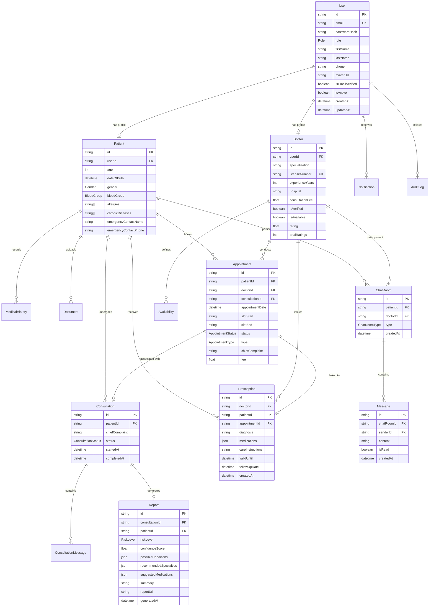

# Database Schema & Entity-Relationship Model

The application utilizes **PostgreSQL** managed through **Prisma ORM**.

---

## 1. Entity-Relationship (ER) Diagram

---

## 2. Key Enums

| Enum | Possible Values | Description |
| :--- | :--- | :--- |
| `Role` | `PATIENT`, `DOCTOR`, `ADMIN` | User access level across the platform. |
| `Gender` | `MALE`, `FEMALE`, `OTHER`, `PREFER_NOT_TO_SAY` | Patient biological/identified gender. |
| `BloodGroup` | `A_POSITIVE`, `A_NEGATIVE`, `B_POSITIVE`, `B_NEGATIVE`, `AB_POSITIVE`, `AB_NEGATIVE`, `O_POSITIVE`, `O_NEGATIVE`, `UNKNOWN` | Blood group identification. |
| `AppointmentStatus` | `SCHEDULED`, `CONFIRMED`, `COMPLETED`, `CANCELLED`, `NO_SHOW` | Current state of doctor booking. |
| `AppointmentType` | `IN_PERSON`, `ONLINE_VIDEO`, `PHONE` | Consultation medium. |
| `RiskLevel` | `LOW`, `MEDIUM`, `HIGH`, `CRITICAL` | AI triage classification. |
| `ConditionType` | `CHRONIC`, `ACUTE`, `SURGERY`, `ALLERGY`, `GENETIC`, `OTHER` | Category in medical history. |
| `Severity` | `MILD`, `MODERATE`, `SEVERE`, `CRITICAL` | Patient condition intensity. |
| `DocumentType` | `PRESCRIPTION`, `LAB_REPORT`, `IMAGING_XRAY`, `IMAGING_MRI`, `IMAGING_CT`, `DISCHARGE_SUMMARY`, `OTHER` | Categorization for uploaded records. |
| `AuditAction` | `USER_REGISTERED`, `USER_LOGIN`, `USER_LOGOUT`, `APPOINTMENT_BOOKED`, `CONSULTATION_STARTED`, `REPORT_GENERATED`, etc. | Security audit event types. |

---

## 3. Database Indexing Strategy

1. **User Table:**
   - Unique Index on `email`.
   - Index on `role` and `isActive` for swift filtering during admin operations.
2. **Appointment Table:**
   - Composite index on `[doctorId, appointmentDate, slotStart]` ensuring rapid slot lookup and avoiding double-booking collisions.
   - Index on `patientId` for fast retrieval of patient consultation history.
3. **Prescription Table:**
   - Index on `patientId` and `createdAt` to support quick dashboard rendering of recent medication plans.
   - Index on `appointmentId` to link prescriptions with specific consultation sessions.
4. **Chat & Message Tables:**
   - Index on `[chatRoomId, createdAt]` to paginate message histories in milliseconds.
