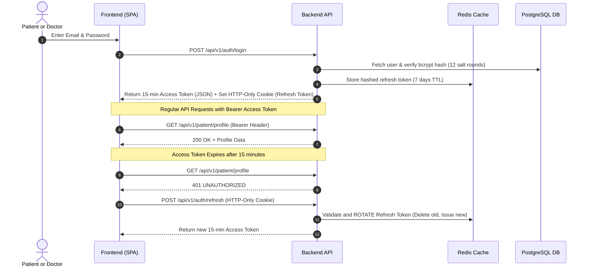

# Security, Compliance & Data Protection

Security and privacy are fundamental considerations in healthcare technology. This document outlines the safeguards implemented across the DocAI platform.

---

## 1. Authentication & Session Security



### Security Measures:
1. **Short-Lived Access Tokens:** Expire in 15 minutes to limit exposure if intercepted.
2. **Refresh Token Rotation:** Refresh tokens are single-use. Issuing a new access token burns the existing refresh token and generates a new hashed pair.
3. **Instant Revocation:** Logout immediately deletes all user session tokens stored in Redis.
4. **HTTP-Only Cookies:** Prevents Cross-Site Scripting (XSS) attacks from extracting refresh credentials.

---

## 2. Role-Based Access Control (RBAC)

The system enforces strict route authorization middleware:
- **`PATIENT`**: Restricted to own profile, medical records, document uploads, personal AI consultations, and booking doctor appointments.
- **`DOCTOR`**: Restricted to verified doctors for managing clinical schedules, viewing assigned patients, and issuing official prescriptions.
- **`ADMIN`**: Restricted to verifying doctor credentials, viewing system metrics, activating/suspending accounts, and inspecting audit trails.

---

## 3. Rate Limiting & Denial of Service Protection

Implemented using `express-rate-limit` with an Upstash Redis store:
- **Global API Rate Limit:** 100 requests per 15 minutes per IP.
- **Authentication Rate Limit:** Max 10 attempts per 15 minutes per IP on `/login`, `/register`, and `/forgot-password` to prevent brute force credential attacks.

---

## 4. Comprehensive Audit Logging

All sensitive actions trigger an asynchronous write to the `AuditLog` table:
```json
{
  "userId": "cm1abcdefg000008l01",
  "action": "DOCUMENT_UPLOADED",
  "entity": "Document",
  "entityId": "doc-uuid-9912",
  "ipAddress": "192.168.1.1",
  "userAgent": "Mozilla/5.0 ...",
  "timestamp": "2026-10-05T14:30:00.000Z"
}
```
Tracked events include: `USER_REGISTERED`, `USER_LOGIN`, `USER_LOGOUT`, `APPOINTMENT_BOOKED`, `CONSULTATION_STARTED`, `REPORT_GENERATED`, `PRESCRIPTION_ISSUED`.

---

## 5. Healthcare & Medical Disclaimer Compliance

- **Prominent Disclaimers:** All AI-assisted features display unambiguous notifications stating that outputs are informative summaries, not formal diagnoses.
- **Human-in-the-Loop:** AI suggestions never issue medication prescriptions autonomously. Prescriptions can only be created and signed by verified doctors.
- **Doctor Verification Gate:** Newly registered doctors cannot accept patient appointments until an administrator verifies their medical license and qualifications.
